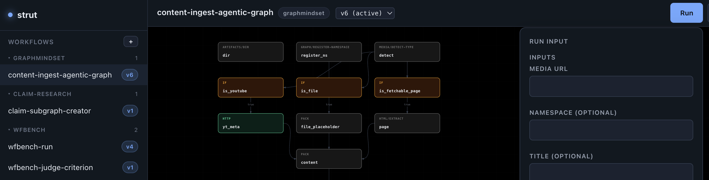

<h1 align="center">strut</h1>

<p align="center"><strong>An agent-native workflow engine.</strong><br/>
An AI builder that writes workflows for you, a visual editor, and an HTTP api.</p>

<p align="center">
  <a href="#quick-start">Quick start</a> ·
  <a href="#connect-your-agent">Connect your agent</a> ·
  <a href="#workflows">Workflows</a> ·
  <a href="#steps">Steps</a> ·
  <a href="#agents">Agents</a> ·
  <a href="#web-ui">Web UI</a> ·
  <a href="#use-as-a-library">Library</a>
</p>

<p align="center">
  
</p>

---

`strut` runs workflows that are small enough for a person to read and regular enough for an LLM to write. A workflow is an ordered list of steps, each with a type, a config, and optional dependencies. Templates like `{{ input.repo }}` wire step outputs together.

Steps do the work. Core steps cover HTTP, subprocesses, branching, loops, LLM calls, and full agent loops. Library steps add integrations like GitHub, Slack, and a knowledge graph. Custom steps are small TypeScript files you (or the AI builder) add at runtime.

Use it three ways:

1. **Run the server.** API plus web UI on one port.
2. **Embed it.** `createStrut()` gives you a Hono app and a `run()` function.
3. **Package it for the desktop.** A self-contained tarball with local speech-to-text built in.

## Quick start

Needs Node 22 or newer.

```bash
git clone https://github.com/stakwork/strut.git
cd strut
npm install
npm --prefix web install
```

Create a `.env` in the repo root:

```ini
STRUT_WORKSPACE_BACKEND=fs      # keep workflows on disk, no Neo4j needed
# STRUT_CLAIMS=0                # graph workspaces: turn the claims/checks/evidence layer off
ANTHROPIC_API_KEY=sk-ant-...    # for llm/agent steps and the AI builder — or OPENAI_API_KEY,
                                # GOOGLE_API_KEY, OPENROUTER_API_KEY, XAI_API_KEY; pick the model in
                                # the AI chat. Keys can also be pasted under Secrets in the UI.
# STRUT_API_KEY=…               # shared secret every request must carry (Bearer, or ?key= — the UI
                                # asks for it once). Unset, every endpoint is open: fine on your
                                # laptop, set it before anyone else can reach the port.
# STRUT_SECRET_KEY=…            # passphrase encrypting the secret store (what you paste under
                                # Secrets). Unset, a fixed dev passphrase is used. Any long random
                                # string (`openssl rand -hex 32`); set it before the first secret is
                                # stored — changing it later locks the stored ones out.
```

Then:

```bash
npm run dev
```

Open http://localhost:3000, and ask the AI builder for a workflow or draw one on the canvas.

### Docker

The same thing with the tools workflows call (ffmpeg, yt-dlp, tesseract, uv, …) already in the image. The compose pulls the published images (`ghcr.io/stakwork/strut`, built from main on every merge, and its browser) and runs the graph backend beside its own Neo4j (Browser at http://localhost:7475, `bolt://localhost:7689`, `neo4j` / `testtest`). It reads the same `.env`; three lines are enough:

```ini
STRUT_API_KEY=…                 # openssl rand -hex 32 — every request carries it; set it before anyone else can reach the port
STRUT_SECRET_KEY=…              # openssl rand -hex 32 — encrypts the secret store; set it before the first secret is stored
ANTHROPIC_API_KEY=sk-ant-...    # or any provider key above
```

```bash
docker compose up -d
```

Then open the UI with the key once — it keeps it for the session and strips it from the address bar — or paste it under Settings → Connection:

```bash
open "http://localhost:3000/?key=$STRUT_API_KEY"
```

To run your checkout's code instead: `docker compose -f docker-compose.yml -f docker-compose.build.yml up --build`. For a clean slate, `docker compose down -v` removes the containers and every volume (Neo4j, workspace, model cache).

## Connect your agent

Strut is an MCP server. An agent you already use — Claude Code, Codex, Hermes — connects to it over HTTP and gets seven tools: talk to strut's workflow builder, read that conversation back, list workflows and runs, read a run, run a workflow. The agent never learns strut's YAML; it asks the builder in plain words and gets back what was built, with links it can hand on to its own connectors. Every artifact link is absolute and carries its own read token, so it opens the file by itself.

Two headers: the key as a bearer token (drop it when `STRUT_API_KEY` is unset), and `x-strut-actor`, a name for the caller — MCP has no identity of its own — so the chats, runs and workflows it makes are stamped, and it finds its own chats again.

**Claude Code**

```bash
claude mcp add --transport http strut http://localhost:3000/mcp --header "Authorization: Bearer $STRUT_API_KEY" --header "x-strut-actor: claude"
```

**Codex** — in `~/.codex/config.toml` (or a trusted project's `.codex/config.toml`), with `STRUT_API_KEY` exported in the environment Codex runs in:

```toml
[mcp_servers.strut]
url = "http://localhost:3000/mcp"
bearer_token_env_var = "STRUT_API_KEY"
http_headers = { "x-strut-actor" = "codex" }
```

**Hermes** — in `~/.hermes/config.yaml`, then `/reload-mcp` in a session (`hermes mcp test strut` shows what the server answered):

```yaml
mcp_servers:
  strut:
    url: "http://localhost:3000/mcp"
    headers:
      Authorization: "Bearer <your STRUT_API_KEY>"
      x-strut-actor: "hermes"
```

Then ask your agent for a workflow the way you would ask a colleague — "make a workflow that fetches the Hacker News front page every morning and writes a markdown summary, run it once, and give me the link" — and it talks to the builder for you. A build that outlives one call comes back as `working`; the agent reads the chat again until it is done. If the builder has a question, the agent relays it, and a secret it needs is entered by you under Secrets in the UI, never through the agent.

For an agent that should author workflows itself, with the builder's own tools and the full prompt, point it at `/mcp/builder` instead. [specs/API.md §11](specs/API.md) has every tool's arguments and results.

## Workflows

Steps run in order unless `depends` says otherwise. Any config value can hold a `{{ }}` expression that reads the run's `input`, the workflow's `params`, or an earlier step's output.

```yaml
name: review-pr
steps:
  - id: fetch
    type: github/fetch-pr
    config:
      owner: "{{ input.owner }}"
      repo: "{{ input.repo }}"
      pull_number: "{{ input.number }}"

  - id: review
    type: llm
    config:
      model: "{{ params.model }}"
      prompt: |
        {{ params.instructions }}

        {{ fetch.markdown }}

  - id: notify
    type: slack/post-message
    config:
      channel: "#code-review"
      text: "*{{ fetch.pr.title }}*\n{{ review.text }}"

params:
  model: claude-sonnet-5-5
  instructions: You are a senior engineer reviewing a pull request. Be concise.
```

`depends: [a, b]` waits for both steps; steps with the same dependencies run concurrently. `params` are the tunable knobs, and any run can override one without publishing a new version. Workflows are versioned, so every publish is a rollback point.

## Steps

Core steps: `http`, `exec`, `log`, `if`, `loop`, `foreach`, `subflow`, `wait`, `pack`, `llm`, `agent`.

Library steps ship with the engine and load their SDKs only when used: `github/*`, `slack/*`, `x/*`, `gdrive/*`, `html/*`, `graph/*`, and `meta/*` (steps that author and run other workflows).

Custom steps are one file each. Drop it in the workspace and it is ready to use:

```ts
// workspace/steps/custom/word-count.ts
import { z, defineStep } from "strut";

export default defineStep({
  type: "word-count",
  input: z.object({ text: z.string() }),
  output: z.object({ words: z.number() }),
  async run(cfg) {
    return { words: cfg.text.trim().split(/\s+/).length };
  },
});
```

## Agents

The `agent` step runs a model in a tool loop. **Tools are steps**: name any step types in `agentTools` and each one becomes a tool the agent can call. Every call is logged as a nested step in the run.

```yaml
- id: triage
  type: agent
  config:
    cwd: "{{ input.repoDir }}"
    system: You are a release engineer.
    prompt: Find the failing test and explain the root cause.
    agentTools: ["github/*", "graph/graph-search"]
    finalAnswer: The root cause, in two sentences.
```

The AI builder in the web UI is the same thing pointed at the `meta/*` steps. It can search the catalog, write a step, publish a workflow, run it, read the results, and iterate.

## Web UI

- **Canvas editor.** Drag to connect steps, click a node to edit it, add steps from a searchable picker.
- **Runs.** Watch events live, see each node go green, red, or yellow. Cancel, pause, and resume.
- **AI builder.** A chat that authors workflows and steps against your live workspace.
- **Dictation.** Local speech-to-text, built in.
- **Secrets.** Add credentials once, encrypted at rest.

## Use as a library

```bash
npm install stakwork/strut
```

```ts
import { createStrut } from "strut";

const strut = await createStrut();
await strut.listen(3000);                  // API + web UI
// or mount it: app.route("/strut", strut.app);

await strut.run("review-pr", { owner: "stakwork", repo: "strut", number: 42 });
```

Stores, the step registry, and a `services` bag for your steps are all injectable through `createStrut()`.

## Going deeper

- [specs/API.md](specs/API.md): the HTTP API, with request and response shapes and a worked run.
- [specs/SPEC.md](specs/SPEC.md): the engine design.
- [specs/RUN_CONTROL_SPEC.md](specs/RUN_CONTROL_SPEC.md), [specs/EVAL_SPEC.md](specs/EVAL_SPEC.md), [specs/EVOLVE_SPEC.md](specs/EVOLVE_SPEC.md): run control, evals, and self-evolving workflows.
- [AGENTS.md](AGENTS.md): environment variables, auth, the Neo4j graph backend, desktop packaging, and how to work on the codebase.

`npm test` runs the unit suite.

## License

[Apache 2.0](LICENSE)
