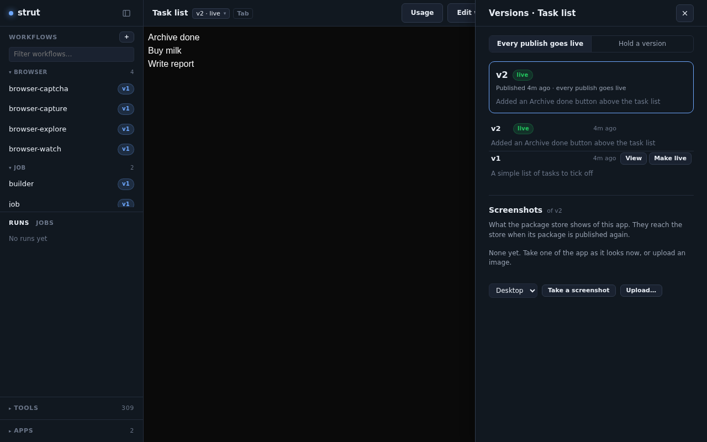

# App version summaries

Status: built. Every new app version gets a system-written ONE-LINE summary of
what it changed, shown wherever versions are listed.

## What was built

- `AppVersionInfo.summary?: string` (src/workspace.ts), so it flows into
  `AppVersionSummary`, `AppRecord.versions` and `GET /apps/:name/versions`.
- `src/apps/summary.ts`: `appDiff` (compact per-file removed/added lines,
  capped), `oneLine`, and `llmSummarizer`, the default summarizer.
- `WorkspaceStore.setAppVersionSummary(name, version, summary)`.
- UI: the Versions flyout (each row's second line, and the live card), the side
  panel's version list, the Publish dialog's Public view tab and the
  `app/make-public` card name a version with its summary.

## Where it is stored

No new table or file. On files, `summary` on the version in
`apps/<name>/_metadata.json`; on the graph (Neo4j and LadybugDB), a `summary`
attribute on `StrutAppVersion` (declared in src/graph/strut-schemas.ts).
`fs-import` carries it across.

## How it is generated

`createApps.publish` records the version first. For a new version (`changed`,
not a `seed`) it then starts a background job, covering both `app/publish` and
`POST /apps`: the version's files are diffed against the version before it
(read from the recorded trees) and the diff goes to the summarizer; the line it
returns is written onto the version. The first version has no diff, so the
model says what the app is.

It never blocks or fails a publish. A throw, a 20 s timeout
(`summaryTimeoutMs`) or no key leaves the summary empty and logs
`[apps] summary for <name>@<v> not generated: …`.

Model: alias `haiku`, through `resolveModel` with the secrets boundary and the
`llmAuth` gateway hook. No environment variable. With no model available, the
first version reads "Initial version"; later versions stay empty. Tests inject
their own summarizer (`AppsDeps.summarize`).

## Limits

- `app/publish`'s response (and `POST /apps`') cannot carry the summary: it
  arrives after the answer. Read it from `app/get` or the versions listing.
- No backfill: versions published before this stay empty and show nothing.
- A pending summary renders nothing.

Tests: src/apps/summary.test.ts, a graph-store case in
src/graph/workspace-store.test.ts, web/src/app-versions.test.ts.
