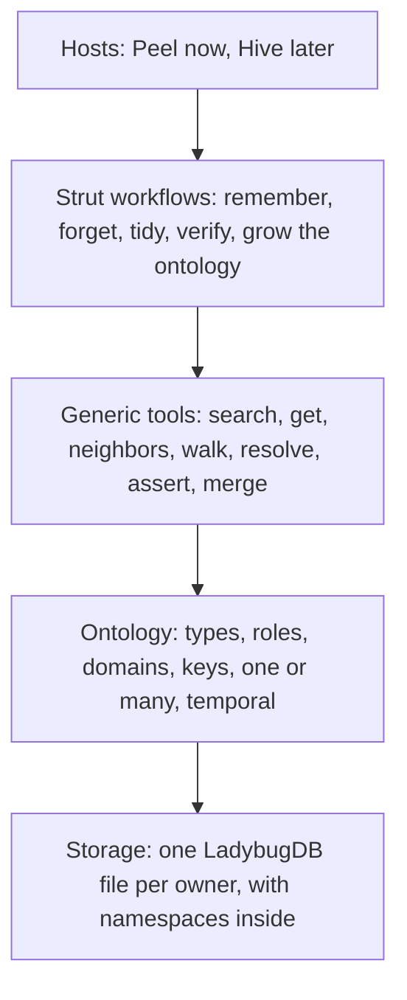
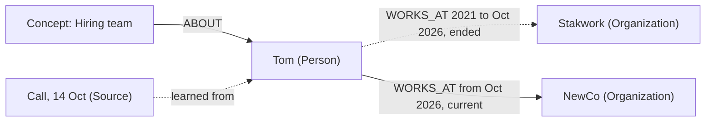
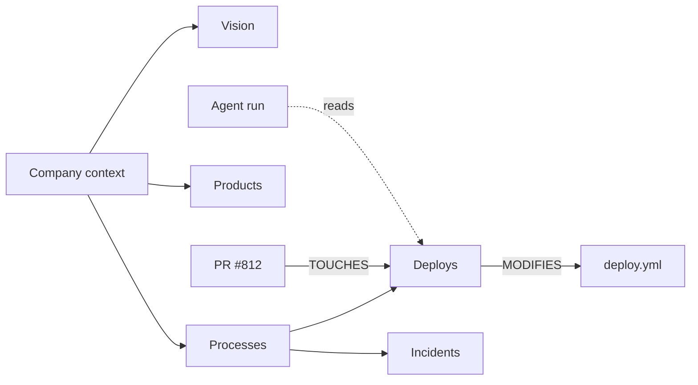
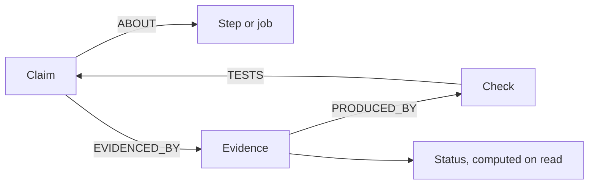
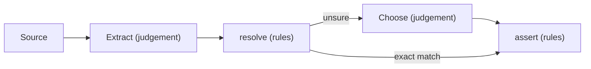
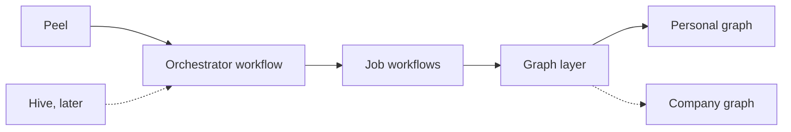

# Graph Memory

One graph layer inside strut that gives an agent a working memory of people, conversations, work and code. We build it for Peel first and extend it to Hive if it works.

## Why we're doing this

Agents are only as useful as what they know. A good assistant knows who people are, what was said, what changed and what's true today. Peel and Hive both need that, and both run the same strut orchestrator and job workflows.

What we have today grew in pieces. Peel's memory started as a separate store, and the company graph depends on Jarvis's ontology and conventions. Time is handled three different ways: Jarvis's temporal edges, strut's Claims, and Peel's Facts, and the last of those isn't needed. Treating "memory" as a special kind of node also created a wall between what the agent remembers and everything else in the graph, such as calls, messages and code.

**The whole graph is memory.** We want one simple model, built on core pieces we own, that a personal agent and a company can both use.

### Goals

- One model for everything an agent knows, with no separate memory layer.
- The ontology is data, so new kinds of knowledge need no release.
- Time, one-or-many and identity are handled the same way for every type.
- Everything is searchable, walkable and traceable to its source.
- Domain knowledge lives in Concepts, which agents walk like skill files in graph form.
- Claims stay at the centre of how strut knows something works.
- No dependency on Jarvis.

### Not in v1

- Company memory. It comes after Peel passes.
- Decay and confidence scoring. They can be added later without changing what's stored.
- Building Concepts automatically from code and PRs. In v1, a Concept is written with create and edit node, and stakgraph's lab workflows can do the automated part at the Hive stage.
- Edge weights learned from outcomes, and a ranked walk. Hive's plan describes both.

## What we're building on

| From | We keep | We leave |
| --- | --- | --- |
| **Jarvis** | Ontology as data, temporal rules and one-or-many declared on the schema, the epistemic model behind Claims | The service, the 151-type seed, hidden-domain rules |
| **Strut** | The workflow engine, Concept pages, `graph/walk`, Claims, Checks and Evidence, `ACCESSED` records | Jarvis-shaped conventions on Peel's path |
| **Hive's graph memory plan** | Code for invariants and agents for judgement, the Entity, Source and Concept roles, Concepts tied to their evidence | Free-text relations with no schema: we keep a typed, dynamic ontology |
| **Stakgraph** | Code as nodes, and Concepts built from PRs and commits | Nothing yet: it joins at the Hive stage |
| **Mem0 and Graphiti** | Bi-temporal relationships and entity resolution as ideas | The Fact node layer |

## What memory has to do

| Need | Meaning |
| --- | --- |
| **Find** | Given a name or a meaning, find the thing. |
| **Connect** | Follow how things relate. |
| **Know when** | Say what's true now and what was true then. |
| **Know why** | Show where something came from. |
| **Stay one** | The same person or thing is one node, however often it's mentioned. |
| **Keep learning** | Take in calls, messages and code without hand-modelling. |
| **Stay private** | Only the right people and agents can read it. |
| **Explain itself** | An agent can ask what kinds of things exist, and new kinds can be added at any time. |
| **Teach** | An agent learns how things work here by walking domain knowledge, one page at a time. |
| **Prove** | Statements about how something should behave are tested, and their status comes from evidence. |

## User stories

### Personal, in Peel (v1)

| ID | As a Peel user, I want… | So that… |
| --- | --- | --- |
| P1 | to ask "where does Alice work?" and get today's answer | I don't have to remember or look it up |
| P2 | to mention that something changed and have it updated | I never have to clean up old facts |
| P3 | to ask what was true last year | past context isn't lost when things change |
| P4 | to ask "how do you know that?" and see the message or call | I can trust or correct it |
| P5 | one person to stay one person across my chats and calls, and two Johns to stay two | answers don't mix people up |
| P6 | to say "forget that" | it stops being used |
| P7 | to start talking about something new, such as recipes, and have it remembered properly | memory grows with my life |
| P8 | background jobs that read the web to have no access to my private messages | a bad web page can't reach my data |
| P9 | my home box and my Mac to share the same memory | my assistant is the same on both |
| P10 | to keep work and home apart in one graph | a search about one doesn't fill up with the other |
| P11 | to teach my assistant how I do things once | it follows my way next time without being told |

### Company, in Hive (later)

| ID | As a team member, I want… | So that… |
| --- | --- | --- |
| C1 | to ask "who owns billing?" and get an answer that joins code, PRs, people and decisions | I don't have to ask around |
| C2 | a call to be linked to the code it discussed | the reason behind a change can be found from the code |
| C3 | to see who said what when people disagree | I can weigh it myself |
| C4 | nothing learned from a private channel to reach people outside it | people can trust the system with private conversations |
| C5 | a new agent to start at the company root and walk down to what it needs | it knows our vision, processes and products without a huge prompt |
| C6 | each client's data in its own partition | work for one client doesn't leak into answers for another |

### Builders

| ID | As a workflow author, I want… | So that… |
| --- | --- | --- |
| B1 | to add a type by writing a schema | new knowledge needs no migration code |
| B2 | to call one write that applies the rules | my workflow can't leave two current employers |
| B3 | the same tools for every type | I learn one graph, not several |
| B4 | to add agent knowledge by writing a Concept page | agents pick it up with no prompt or code change |
| B5 | to see which Concepts agents actually use | I can improve the ones that matter and retire the rest |
| B6 | to state a Claim and have it tested | "done" means evidence, not a green run |

## Requirements

| ID | Requirement | Stories | Stage |
| --- | --- | --- | --- |
| R1 | One graph per owner, stored in one LadybugDB file. | P9 | Peel v1 |
| R2 | Every node and edge belongs to one namespace, private by default. Search and walk can scope to one or more. | P10, C6 | Peel v1 |
| R3 | Every type belongs to a domain, and ontology reads can scope by domain. Domains don't control visibility. | B1 | Peel v1 |
| R4 | Every type has a role (Entity, Source, Concept or Claim), which sets its identity and edit rules. | P5, B3 | Peel v1 |
| R5 | Relationships are edges. There is no Fact node. | P1, B3 | Peel v1 |
| R6 | Attributes hold current values only. Anything that needs history or a source is an edge. | P3, P4 | Peel v1 |
| R7 | Types, roles, keys, identifiers, one-or-many and temporal rules are schema data, editable at runtime. | P7, B1 | Peel v1 |
| R8 | Temporal edges keep two clocks: when true in the world, and when the graph believed it. | P2, P3 | Peel v1 |
| R9 | `assert` applies the rules in one transaction: re-confirm, supersede, or create. | P2, B2 | Peel v1 |
| R10 | Reads return current data by default, and history through `include_ended` and `as_of`. | P1, P3 | Peel v1 |
| R11 | Every edge names its sources, and sources are never edited. | P4, C3 | Peel v1 |
| R12 | Search by name and meaning covers nodes and the sentences on edges. | P1 | Peel v1 |
| R13 | Types with a natural key upsert on it, and identifiers are unique within their scope. | P5, C1 | Peel v1 |
| R14 | `resolve` matches key, identifier, then name, and returns candidates without guessing. | P5 | Peel v1 |
| R15 | `merge` moves edges to the winner, keeps old ids working, and can be undone. | P5 | Peel v1 |
| R16 | Deleting is soft, with `deleted_at`, for every type. | P6 | Peel v1 |
| R17 | Concepts are pages in a tree with docs and children. An agent opens one at a time, starting from a root. | P11, B4, C5 | Peel v1 |
| R18 | Concepts link to their sources and to the work they describe. | P4, C2 | Peel v1 |
| R19 | Agent reads of a node are recorded as edges, so Concept use can be counted. | B5 | Peel v1 |
| R20 | Claims, Checks and Evidence stay first-class. Status is computed from evidence, never set. | B6 | Peel v1 |
| R21 | Each reader has a list of namespaces it may read, and one check under every read tool enforces it. An edge is visible only if the reader can see its namespace and both ends. | P8, C4 | Peel v1 |
| R22 | Nothing reaches around access rules, raw queries included. | P8 | Peel v1 |
| R23 | Knowledge moves between a person's machines, checked by hash. | P9 | Peel v1 |
| R24 | Peel's graph boots and runs without Jarvis's seed ontology. | All | Peel v1 |
| R25 | Private channels and teams get their own namespaces, and each person has a list of the ones they can read. | C4 | Company |
| R26 | Code nodes link to people, Concepts and conversations. | C1, C2 | Company |

## Architecture

### Layers



Each layer only talks to the one below. Workflows decide what is true. Tools make sure a write can't break the rules.

### The data model



Things are nodes. Relationships are edges with times and a source. An ended edge stays in the graph, drawn here as a dashed line.

| Part | What it is | Rule | Examples |
| --- | --- | --- | --- |
| **Entity** | A real thing | One node per thing | Person, Organization, File, Function |
| **Source** | What was said or seen | Never edited | Call, Message, Document |
| **Concept** | Domain knowledge, as a page | Can be revised, and links to its evidence | Company context, Deploys, Billing |
| **Claim** | A testable statement | Replaced by a successor, never edited. Status comes from evidence | "The clip contains the quoted moment" |
| **Edge** | A relationship | Carries a sentence, sources and times | `WORKS_AT`, `PREFERS`, `OWNS` |
| **Attribute** | A plain value on a node | Current value only | Birthday, file path |

### Concepts: skills in graph form

Concepts are how an agent learns how things work here. The root holds the context, such as a company's vision, and each page leads to more specific ones. Like a skill file, a page has a short description and full docs, and an agent loads only what it needs. Unlike a skill file, a page has edges, so it can link to the code and PRs behind it, and strut can count which pages agents use.



An agent opens one page, sees its children, and opens only what it needs. Edges tie a page to the code and work behind it, and to the runs that used it.

The reading part works today, on both backends: `context/concept` puts a root and its children in an agent's prompt, and `graph_get` opens the next page. Hive's Jamie already walks from Glimmer to Stadeum to Jamie in its concept-tree mode. Recording use only works on Neo4j, through `ACCESSED` edges, so Peel needs a run-read record added on Ladybug.

### Claims: how we know something works



Nobody sets the status. It comes from the evidence each time it's read: supported, refuted, stale or unknown.

Edges say what the graph currently believes. Claims say what should hold, and whether the evidence agrees. Claims stay as they are in v1.

### Namespaces and domains

Namespaces split the data, shown here as columns, and set who can read it. Domains group the types, shown here as rows, and control nothing.

|  | Splits | Used for | Example |
| --- | --- | --- | --- |
| **File** | Owners | The hard boundary: one person or one workspace | Tom's graph, a company's graph |
| **Namespace** | Data | Keeping searches, walks and keys apart within a file, and setting who can read what | Work and home, one client, one repo |
| **Domain** | Types | Showing an agent the part of the ontology it needs | People, Code, Knowledge, Epistemic |

Namespaces are also the privacy boundary, because one check under every read tool is hard to get wrong. In Peel, everything goes in `private` by default and public Concepts go in `shared`. The assistant reads both, and jobs read only `shared`. Domains never control visibility: Jarvis used them that way, and untangling it took a dedicated cleanup. Ladybug's backend refuses any namespace but `default` today, so this is new work there.

### The schema carries the rules

```yaml
Person:
  role: entity
  domain: People
  identifiers: [email, phone, github]   # generated id; each value is unique

Message:
  role: source
  key: [channel, message_id]            # natural key, upserts

Topic: {}                               # no key: name and aliases only

Concept:
  role: concept
  domain: Knowledge

WORKS_AT:
  from: Person
  to: Organization
  temporal: true
  cardinality: one                      # one current edge per Person

PREFERS:
  from: Person
  to: Topic
  temporal: true
  cardinality: many
```

Strut seeds the base types. Hosts and apps add their own. The ontology workflow can propose new types, and a new type gets no key by default, because a wrong key merges things that aren't the same. Adding an identifier is always safe. Adding or changing a key on a type that already has nodes is a migration.

### Core attributes

| On | Attributes |
| --- | --- |
| **Every node** | `ref_id`, `node_type`, `namespace`, `key`, `name`, `description`, `aliases`, `search_text`, `text_embeddings`, `created_at`, `created_by`, `updated_at`, `deleted_at` |
| **Every edge** | `ref_id`, `namespace`, `created_at`, `created_by`, `updated_at`, `deleted_at` |
| **Temporal edges also** | `text`, `sources`, `valid_at`, `invalid_at`, `expired_at`, `superseded_by`, `last_confirmed_at` |

Every time is epoch milliseconds. Only the writer sets `ref_id`, `created_at`, `created_by` and `updated_at`. Everything else belongs to its type, such as `docs` on Concept and `email` on Person.

### Identity

| Kind | Examples | How identity works |
| --- | --- | --- |
| **Natural key** | File, Function, Message, Call | The write upserts on the key, so dupes can't happen. |
| **Strong identifier** | Email, phone, GitHub handle | Generated id, plus unique identifiers. They join one person across systems. |
| **Name only** | Topic, or a Person with no identifier | Generated id, plus name and aliases. A workflow resolves them. |

Names are never keys. Two Johns would collapse into one, and one person with three names would still be three nodes. A duplicate can be merged later, while a wrong merge mixes two people's history, so when unsure we create a new node.

### Searching edges

We tested this on a scratch LadybugDB. Edges can hold a sentence and an embedding, and a query can scan them, but Ladybug refuses to build a text or vector index on an edge table. It reports that the table "is not of type NODE".

| Option | How it works | Trade-off |
| --- | --- | --- |
| **Search rows** (chosen) | Each edge's sentence and embedding also go in a hidden row in the node table, pointing at the edge. `assert` keeps them in step. | Uses the existing indexes. At 50k edges a prototype took 3 ms for keyword and 22 ms for vector search, and each write took about 10 ms longer. It's an index, and nothing reads it as a node. |
| **Scan edges** | Compare the query against every edge at search time. | No extra data. At 50k edges vector search took 62 ms and keyword search was substring only, with no ranking. It slows as the graph grows. |
| **Search nodes only** | Find the node, then read its edges. | Simplest, but a query matching only an edge's sentence finds nothing. |

### How the graph learns



A model reads and decides. Code finds nodes and writes. The model is only asked to choose when code can't match exactly.

### Tools

| Generic tools, in code | Strut workflows, on top |
| --- | --- |
| **Read:** search, get, neighbors, walk, ontology, each scoped by namespace **Write:** define type, create, edit, soft delete, `assert`, `merge` **Identity:** `resolve` | **Remember:** read a source and assert what it says **Forget:** end or remove on request **Tidy:** find and merge duplicates **Verify:** run Checks and record Evidence **Grow the ontology:** propose new types |

### Personal and company share one architecture



Hive's Jamie already runs strut's orchestrator. Hosts differ in what they grant and whose graph they open.

## Worked examples

These walk through the designed behaviour. None of it is built yet, and the names and dates are made up.

### A fact changes

"Tom left Stakwork and joined NewCo last month."

1. **Extract** finds one relationship: Tom `WORKS_AT` NewCo, from October.
2. **resolve** finds Tom by exact name. NewCo has no match, so it's created.
3. **assert** reads the schema and sees `cardinality: one`. It finds the current edge to Stakwork, ends it, and creates the new one, in one transaction.

| Edge | valid_at | invalid_at | Sources | State |
| --- | --- | --- | --- | --- |
| Tom → Stakwork | 2021-03 | 2026-10 | Message, 2 Mar 2021 | Ended |
| Tom → NewCo | 2026-10 | — | Call, 14 Oct | Current |

Both edges stay in the graph. The read decides which one you see.

### The same thing is said twice

A week later, in a message: "Tom's at NewCo now."

`assert` sees the same from, type and to on a current edge. It adds the message as a second source and creates nothing new.

One edge with two sources. Different wording doesn't make a new edge.

### Two Johns, then a duplicate

"John from sales called about the renewal."

1. **resolve** finds two people called John and returns both as candidates. It doesn't pick one.
2. **Choose:** the workflow reads the context. Neither John is in sales, so it isn't sure and creates a new John.
3. Later, an email from john@acme.example arrives. The address matches an identifier on an existing John, and the sales John has that same address in a signature.
4. **Tidy** sees the match and calls `merge`. The duplicate is soft deleted, its edges move over, and its old id now points to the winner.

One John, with every edge in one place and a record of the merge, which can be undone.

### Something new comes up

"Tom prefers oat milk. My sourdough recipe uses 20% rye."

1. `PREFERS` exists with `cardinality: many`, so "oat milk" becomes a Topic and the edge is added. Earlier preferences stay current.
2. No Recipe type exists. The workflow proposes one and writes it as schema, with no key.
3. "Sourdough" becomes a Recipe node, linked to Rye with a `USES` edge carrying the sentence.

A new type, with no code change or release.

### A job can't read private knowledge

A background job, reading web pages about NewCo, searches the graph for "NewCo".

Tom's `WORKS_AT` edge lives in `private`, and the job may read only `shared`, so search leaves it out. A raw query is refused. Asked the same thing, Tom's own assistant sees the edge.

The job gets only what's in `shared`, such as public Concepts. If it needs a private detail, the assistant puts it in the job's brief. Jobs have read-only graph tools in v1, so a bad web page can't write anything the assistant later trusts.

### An agent learns how something is done

A job is asked: "Ship the fix to staging."

1. The job starts with the root Concept's description and the names of its children.
2. It opens Processes, sees Deploys and Incidents, and opens Deploys, whose docs give the steps.
3. Deploys links to `deploy.yml`, so the job reads that file and doesn't have to search for it.
4. Each page it opened gets an `ACCESSED` edge from the run.

The agent loaded three short pages and not the whole handbook. Later, we can see how often Deploys is read, and by which runs.

### A Claim is tested

A clip workflow finishes and says it's done.

1. The workflow has a Claim: "the clip's audio contains the located moment". A Check tests it.
2. After the run, the Check listens to the clip and writes Evidence: the moment is missing.
3. The status is computed on read and comes back refuted, even though the run itself succeeded.
4. Rewording the Claim creates a successor that `SUPERSEDES` it, and the old Claim keeps its Evidence.

"Done" now means the evidence agrees.

### Two clients, one graph

Both Client A and Client B have a Concept called "Renewal process".

Keys are scoped to a namespace, so these are two nodes. A job working for Client A searches with `namespace: client-a` and only gets that one. A company-wide question can search both.

Clean results in one file. Someone without Client B on their list can't read that namespace at all.

### The company case (later)

In Slack: "Sam owns billing now." Later, someone asks: "Who should review the change to `charge()`?"

1. The Slack handle and GitHub handle are identifiers on one Sam, so Slack and code join up without guessing.
2. `assert` adds Sam `OWNS` Billing, a Concept, and ends the previous owner's edge.
3. `graph/walk` goes from the Function `charge()` to the Billing Concept to Sam.

The same tools and the same rules as Peel, with a Slack message as the source.

## Rollout

We build for Peel and prove it on a copy of real memory with a live model. Hive work starts only when Peel passes everything below.

### Pass criteria

These test the finished product. The plan adds step-level tests, including the exact privacy, `assert` and sync rules, which must be agreed before step 3. Most of the risk is in those steps: on Ladybug today, only Concepts, Claims, soft delete and run nodes exist.

1. The assistant finds a person and answers about them using only the generic tools.
2. When a relationship changes, reads show the new one and the old one stays in history.
3. A `cardinality: one` edge never has two current values, even after a failed write.
4. A search matched only by a sentence on an edge still finds that relationship.
5. A search scoped to one namespace returns nothing from another.
6. An agent can start at a root Concept and walk to the page it needs, and its reads are recorded.
7. Claims, Checks and Evidence behave exactly as they do today.
8. Adding a new type needs no code change.
9. Two people with the same name stay two, and a merge can be undone.
10. A job or unlisted workflow can't read anything in `private`.
11. Sync between box and Mac gives matching hashes, and search works straight after a pull.
12. Workflows hold no temporal logic of their own.
13. A fresh Peel graph boots without Jarvis's bundled ontology.

### What this means for current work

This PRD changes the model in the open PRs and in the Peel-first plan, which still has Fact nodes and a "memory" group. Both need reworking once this is agreed. Existing Facts aren't a constraint: we can migrate them later or start from scratch.

| Work | Effect |
| --- | --- |
| [strut#386](https://github.com/stakwork/strut/pull/386) dynamic ontology | Still needed. It brings Schema nodes and runtime types to Ladybug. |
| [strut#385](https://github.com/stakwork/strut/pull/385) writer gaps, read filter | The filter and guards stay useful, but need to move from a "memory" group to namespace lists. |
| [strut#387](https://github.com/stakwork/strut/pull/387) memory onto the workspace graph | Hold. It moves Fact nodes into the graph, and that shape is going away. |
| [peel#447](https://github.com/stakwork/peel/pull/447) graph reads | Hold. Its prompts assume Fact nodes. |

## Open questions

| Question | Why it matters | Next step |
| --- | --- | --- |
| **Do search rows hold up on real data?** | The prototype passed on synthetic data up to 50k edges. Real embeddings and larger graphs weren't tested. | Check during the live model test. |
| **Can one Person span namespaces?** | A node lives in one namespace, so someone known to two private teams needs a rule. Peel isn't affected: its people are all in `private`. | Decide at the Hive stage. |
| **Can edges cross namespaces?** | A shared Concept linking into a client's data needs it, and a scoped walk has to decide whether to follow. | Allow them. A reader sees one only if it can read its namespace and both ends. |
| **When is a statement a Claim, not an edge?** | "Tom works at NewCo" is an edge. "This workflow never drops audio" is a Claim. The line in between isn't drawn yet. | Lean: a Claim when something can test it. |
| **What does Peel learn from?** | V1 learns from conversations with the assistant and sources you share. Reading calls and messages automatically is a separate decision. | Decide after Peel passes. |
| **Does code belong in the same graph?** | Linking calls to code is valuable, but code is large and can be rebuilt from the repo. | Decide at the Hive stage. |
| **Ladybug at company scale?** | It's untested on a real workspace graph. Dropping Jarvis doesn't by itself mean dropping Neo4j. | Load test at the Hive stage. |
