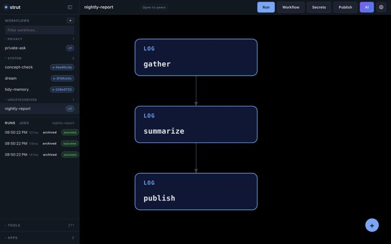
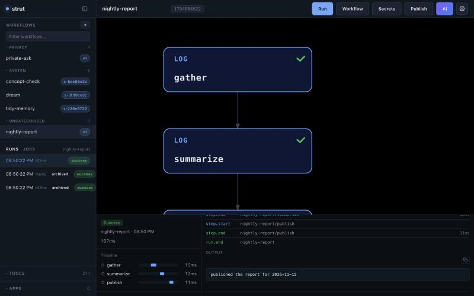
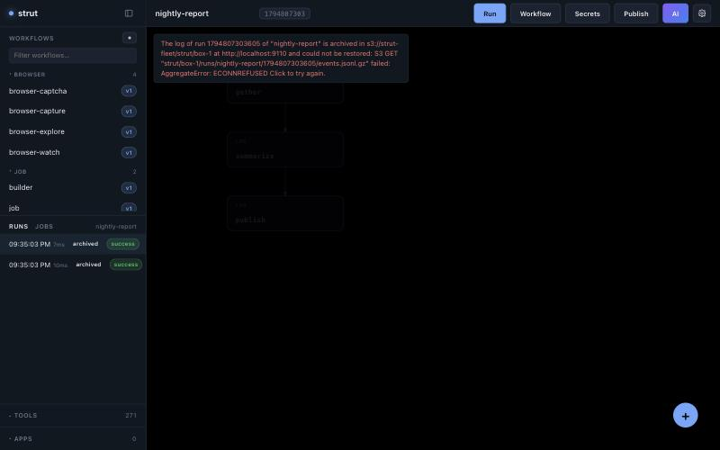

# Run archive: a strut's record in a bucket

> **Status (2026-11-15): phase 1 BUILT** (run logs), in the PR that adds
> this file. Phases 2 to 5 are proposed, nothing built. Ruled by Evan on
> 2026-11-15: an archive tier on the retention sweep; one protocol (S3)
> and one client; one bucket per fleet and one key prefix per box;
> protection is the deployer's job; with no bucket strut behaves as it did.
> Not ruled, and built as proposed: the env var names, the 7-day local
> window, the order of the later phases. Every choice the build made where
> the brief left room is listed in §4.

## Why

Strut boxes fill their disks. One live swarm on 2026-11-15 held, under its
data folder:

| What | Size |
|---|---|
| run artifacts (`artifacts/<runId>/`) | 51 GB |
| run logs (`events.jsonl`), in two workflows | 44 GB |
| job directories (`jobs/`) | 22 GB |
| `steps/` (kept `run_step` runs and step files) | 14 GB |
| repo checkouts (`repos/`, `worktrees/`) | 13 GB |

Run retention landed the same day (`retain:`, `STRUT_RUN_RETENTION`,
`src/retention.ts`, #693 and #698): an hourly sweep that DELETES a finished
run's event log and leaves its summary flagged `logEvicted`. It stops the
disk filling and loses the record. Logs and artifacts are what a run was:
a re-verify of an evicted run has to skip it (`unknown-run`), and an eval
over old runs has nothing to read. All of it will be wanted eventually.

So "evict" becomes: upload first, drop the local copy second, restore on
read. The run summary stays local as the index, so a run still lists and
shows its status with its log gone.

## Decided

- **One protocol, one client.** S3, through the AWS SDK. No Azure bridge,
  no multi-cloud library (flystorage was looked at and turned down: it
  installs every vendor's SDK), no proxy container to hide keys.
- **Protection is the deployer's job**: a key scoped to the box's own
  prefix, on a versioned bucket. Strut overwrites a run's object when the
  run goes on (§1.3) and deletes objects when a workflow is deleted;
  versioning is what makes both recoverable.
- **One bucket per fleet, one prefix per box.** Two managers run strut and
  pass the settings in PRs of their own: sphinx-swarm (the container uses
  the instance role, no keys passed) and Stadeum (a key pair per box).
- **The same shape as the LLM gateway's** `BIFROST_LOGS_S3_*`
  (stakwork/stakgraph#1864), so a manager fills both alike.
- **No bucket, no change.** Retention deletes, as before.

## 1. Phase 1: run logs (built)

### 1.1 Settings

Read through the env boundary (`bootEnv()`), by `archiveFromEnv` in
`src/run-archive.ts`; a host can hand `createStrut({ archive })` instead.

| Variable | Default | |
|---|---|---|
| `STRUT_ARCHIVE_S3_BUCKET` | (unset) | set turns the archive on |
| `STRUT_ARCHIVE_S3_PREFIX` | `strut` | slashes trimmed; a manager sets one per box |
| `STRUT_ARCHIVE_S3_REGION` | `AWS_REGION`, else `us-east-1` | the client needs one even with an endpoint |
| `STRUT_ARCHIVE_S3_ENDPOINT` | (AWS S3) | an S3-compatible store, addressed path-style |
| `STRUT_ARCHIVE_S3_ACCESS_KEY_ID`, `_SECRET_ACCESS_KEY` | (unset) | both or neither; neither is the SDK's default chain |

No step reads them: `STRUT_ARCHIVE_S3_` is in `HIDDEN_FROM_STEPS_PREFIXES`
(`src/env.ts`), so `ctx.services.secrets` answers nothing for them and
`PUT /secrets` refuses them. The key pair goes to the S3 client as an
argument and is never written to `process.env`, so no child inherits it.

One key without the other does not turn the archive off (retention would
then delete what the deployer meant to keep): the archive is on, every
call fails saying which variables to set, and nothing is evicted.

### 1.2 The object store

`src/object-store.ts`: `ObjectStore` is put (streamed), get (streamed),
head and delete. No listing: strut reads an object only by a key it
recorded, so a scoped key needs no `s3:ListBucket`.

`S3ObjectStore` is `@aws-sdk/client-s3` with `@aws-sdk/lib-storage`,
loaded by the first call and never at boot. Checked against the SDK at
3.1169.0 and its docs on 2026-11-15:

- **Checksums.** Since v3.729 the SDK adds a CRC32 to every upload and
  asks for one on every download (`WHEN_SUPPORTED`). AWS's stated fix for
  S3-compatible stores is both options at `WHEN_REQUIRED`
  (aws-sdk-js-v3#6810), which is what the client sets. Each transfer is
  checked by size instead (§1.3).
- **Uploads are multipart** (`Upload`), so the gzipped length need not be
  known and nothing is written to disk first: a full disk can still be
  emptied. A body under one part (5 MB) is a single PUT; a failed upload
  aborts its parts. A PUT of a stream of unknown length is not possible on
  S3. At the default part size one object tops out near 48 GiB.
- **Timeouts.** The SDK's defaults wait forever on an endpoint that never
  answers; the client sets 10 s to connect and 60 s idle.
- **Endpoint.** `endpoint` + `forcePathStyle`, a region always.

`MemoryObjectStore` is the test implementation. The contract is one set
of cases (`src/test-util/object-store-conformance.ts`) run on memory by
`npm test` and on a real store by `npm run test:archive`.

### 1.3 The lifecycle

All of it rides the retention sweep (boot, then hourly, with the
scheduler); `strut.retention.sweep()` runs a pass by hand.

- **Upload.** Every finished run not uploaded yet, gzipped, to
  `<prefix>/runs/<workflow>/<runId>/events.jsonl.gz`. The object's size is
  checked against what was sent, then the summary records it:
  `archive: { key, bytes, size, at }`. Only `events.jsonl`: the three
  files that hold credentials (`callback.json`, `mcp.json`,
  `job-callback.json`) never leave and are deleted with the eviction, as
  before. One sweep uploads at most 4 GiB of log, the logs due for
  eviction first (they are what frees the disk); a backlog drains over
  sweeps and needs no migration.
- **Evict.** By `retain:`, else `STRUT_RUN_RETENTION`, else 7 days. Only a
  run whose upload was recorded, and the store itself enforces it:
  `evictRun` refuses unless `archive.bytes` equals the local log's size. A
  log only grows, so the same size is the same log. A log uploaded on an
  earlier sweep is looked up in the bucket again right before it is
  evicted, and uploaded again if the object is gone or another size (an
  expiry rule shorter than the local window, a manual delete). A crashed
  run is uploaded, then evicted.
- **A run that goes on.** The record lives on the summary, and a durable
  resume drops the summary before it appends. So a resumed run has no
  record, is uploaded again when it finishes (over the same key), and an
  upload a resume overtook is not recorded. An object is read only
  through a summary's record, and a restore refuses an object that does
  not gunzip to exactly `bytes`: a stale object is never taken for the
  log.
- **Restore on read.** The readers of a log's content (`getRunEvents`,
  `tailEvents`, `getRunStart`, `readLogTail`, `repairLog`) first bring
  back a log that is in the bucket and not on this disk, one restore at a
  time per run. Every reader works unchanged: the run view, the SSE tail,
  a durable resume, the verify pass (which now verifies such a run where
  it skipped it). A restored log stays a day, then is evicted again with
  no second upload.
- **A scan never restores.** A read of one run someone asked for restores
  it. A scan over many runs must not, or one listing pages the whole
  archive back onto the disk. Scans use `localRuns(store)`, where an
  archived run reads as an evicted one (what they saw before): the
  version counts, step stats, a package build's suggestions; the public
  view's index of what a workflow's runs reported skips an evicted run.
  `logSize` and `logWrittenAt` never restore either: boot's resume scan
  asks `logWrittenAt` of every run.
- **A bucket that fails.** Strut boots and runs. Each sweep asks a probe
  first (`<prefix>/archive.json`); when it fails, or an upload fails, the
  sweep uploads and evicts nothing more and says so in one line. Boot says
  in one line that the archive is on, and whether the bucket works. A read
  of an archived log the bucket cannot give back is an error with the
  reason (503 on `GET …/events`), never an empty run.

### 1.4 The UI

A run whose log is in the bucket and not here shows "archived" where a
deleted log shows "log evicted", and opens like any other run: the read
restores it. While it restores the canvas says so; a failure shows the
server's reason.

From the pass on a running strut with MinIO (2026-11-15): three runs whose
logs are in the bucket, the newest opened (its badge goes once the read
has restored it), and a run opened while the bucket was down.

### 1.5 What a deployer sets up

- A bucket with **versioning on**, and a lifecycle rule that expires
  noncurrent versions and aborts incomplete multipart uploads (a process
  killed mid-upload leaves parts no one aborts).
- A key (or role) scoped to the box's prefix: `s3:PutObject`,
  `s3:GetObject`, `s3:DeleteObject`, `s3:AbortMultipartUpload` on
  `bucket/prefix/*`. Checked on MinIO with exactly that policy.
- A prefix per box. On a swarm it must not start with `swarm`: the
  backup retention there sweeps those prefixes (stakwork/sphinx-swarm#793
  refuses such a prefix for the gateway's logs for the same reason).
- With an instance role and strut in a container: the instance's
  metadata hop limit must let a container reach it. The role is read over
  IMDS, which needs nothing in the env. The SDK's other sources (ECS,
  EKS) read `AWS_*` from `process.env`, which the default server empties:
  name them in `STRUT_ENV_KEEP`.
- Expiry, if ever wanted, is a bucket lifecycle rule. Strut never expires
  an archived log.

## 2. Later phases (proposed)

In the order of what they free. Each reuses the object store, the sweep's
budget and failure handling, and the rule that a summary or record stays
local as the index.

### Phase 2: run artifacts, one tarball per run (51 GB)

`<prefix>/runs/<workflow>/<runId>/artifacts.tar.gz`, recorded on the
summary beside `archive`.

- **A tar that keeps what is there.** `src/tar.ts` writes regular files
  only and builds the archive in memory from buffers. A checkout inside an
  artifact directory would lose its symlinks and executable bits, and a
  multi-GB directory cannot be held in memory. This phase needs a
  streaming tar that carries modes and symlinks (a streaming writer of
  our own, or the system `tar` through the shell service), and a restore
  that refuses a path leaving the run's directory.
- **Restore on read** has more doors than a log: `ctx.services.artifacts`
  (`read`, `dir`: an agent's `cwd`), `GET /artifacts/:runId[/path]`, the
  file tokens, and the links other runs hold. `dir()` hands out a path, so
  the restore has to happen when the path is asked for.
- **Listing without restoring.** `GET /artifacts/:runId` lists files. Keep
  the file list (paths, sizes) local when the tarball is made, so a
  listing never downloads it.
- **References.** Retention skips a run whose artifacts another run's
  summary names. With restore on read that skip can go for artifacts.
- **A job run's files are the job's** (phase 3), not artifacts.
- **Part size.** Above ~48 GiB compressed an upload needs a larger part
  size than the default.

### Phase 3: job directories (22 GB)

A job directory holds the job's files and its repositories. The record
(`job.json`) stays local as the index. The repositories are checkouts and
are already swept (`STRUT_WORKDIR_TTL_DAYS`); the rest is what to archive,
as one tarball per job once the job has been idle for a window. It needs
phase 2's tar, a restore on `job/dir`, `job/get` and the job file route,
and a decision on what "idle" means for a job a conversation may continue
months later.

### Phase 4: the `step:` and `check:` run buckets (14 GB under `steps/`)

The sweep walks workflow keys only. These buckets have no `retain:`, so
they need a policy (the fleet default) and a key mapping
(`<prefix>/steps/<type>/runs/<runId>/…`). First, the verify pass's cost
sums (`spentToday`, `costOf`) read every check run's LOG to add up what it
cost; a check run's summary has to carry its cost before its log can
leave, or each sum restores the bucket.

### Phase 5: the repository cache (13 GB)

Not an archive: `repos/<host>/<owner>/<name>.git` and `worktrees/<runId>`
can be cloned again. Prune by last use, and remove a worktree whose run
is over.

### Not planned

- Another protocol. An Azure or GCS deployment puts an S3 gateway in
  front, or waits for a ruling.
- A status page (how much is archived, how much waits). The sweep's log
  line is the only report today.
- A bulk restore, or a cap on restores. A day's keep is the only bound on
  what reads bring back.

## 3. Verified, and not

Verified on 2026-11-15: `npm test`; the live suite against MinIO
(RELEASE.2025-09-07), with the root key and with a key scoped to one
prefix and no `s3:ListBucket`, a multipart upload included; one pass on a
running strut with MinIO, from a run to its object, its eviction and its
restore in the UI.

Not verified: AWS S3 itself, the instance-role path, and any other
S3-compatible store (R2, B2, Spaces, Ceph). Two things there are handled
from the docs alone: AWS answers 403, not 404, for a missing key when the
caller may not list (the probe writes and reads again before it concludes
anything), and a region is always sent.

## 4. Choices the build made

Where the brief left room, or the code turned out other than it assumed:

1. **The archive attaches to the store the host passes.** mcp's lab hands
   `createStrut` its own `FileRunStore`, so an archive built into strut's
   default store alone would never run there. `createStrut` gives the
   archive to whatever store it has (`RunStore.useArchive`).
2. **Bulk scans read locally** (`localRuns`), §1.3. The brief asked for
   every read to restore; four readers walk every run of a workflow
   (version counts, step stats, build suggestions, the public view's
   index) and would have paged the archive back in.
3. **`logSize` and `logWrittenAt` do not restore.** Boot's resume scan
   calls `logWrittenAt` on every run. `logSize` answers from the record,
   so a resume's size cap still sees an archived log's real size.
4. **The record is on the summary**, which is what makes "resumed, so
   upload again" fall out of the existing resume (it drops the summary)
   with no new state.
5. **Size is the check** both ways, since the checksum default had to be
   turned off for S3-compatible stores.
6. **Multipart, not gzip-to-a-temp-file**: no disk needed to free disk.
   The cost is `@aws-sdk/lib-storage` beside the client, and the
   incomplete-upload lifecycle rule in §1.5.
7. **Due logs upload first**, and one sweep is bounded by bytes (4 GiB),
   not by count or time.
8. **A restored log stays one day** whatever the policy, so a batch of
   reads (a re-verify over old runs) cannot refill the disk for a week.
9. **A probe object** (`<prefix>/archive.json`) answers "is the bucket
   working" at boot and at each sweep.
10. **Half a key pair leaves the archive on and failing**, not off.
11. **Deleting a workflow deletes its runs' objects.** The person asked
    for the records to go; versioning keeps them recoverable.
12. **No graph field.** A run's projection names its fields one by one and
    takes neither `logEvicted` nor `archive`, so `strut-schemas.ts` is
    unchanged.
13. **`strut.retention`** is on the handle, so a host with
    `scheduler: false`, and a test, can run a pass.
