# Worker pages in Peel's style, and fiat beside sats

Workers reach tasks from Peel. The loading screen, the Tasks app (`strut/worker`) and the staff app (`strut/staff`) now draw as Peel does, and the Tasks page can show what sats are worth in a fiat currency.

## What changed

- **Opt-in theme.** `app.yaml` `theme: peel` (src/apps/manifest.ts → build.json → `GET /public/apps/:name`). The build writes `<html data-peel>` (src/apps/build.ts). Turned on in src/apps/worker/app.yaml and src/apps/staff/app.yaml only; strut/views inside them follows. No other app and none of strut's own UI changes.
- **Kit.** kit/src/styles/base.css "The Peel theme": `--peel-*` tokens (light; dark under `data-theme="dark"`, else prefers-color-scheme), shadcn tokens pointed at them, Button/card/field/badge rules, and the `.wk-*` worker-page classes. Peel's button sizes (sm 28, md 32, lg 40) apply to `[data-slot=button]` for opted-in apps only.
- **Host.** web/src/app-theme.ts, SoloApp.tsx, AppHost.tsx, components.css "The Peel look around a Peel app": `.peel-host` scopes Peel variables to the loading screen (`.app-solo > .empty`, `.app-host-overlay`), the account widget and the host's sheets. A Peel app with no `&theme=` follows prefers-color-scheme.
- **Worker app.** src/apps/views/src/components/WorkerTask.tsx and TaskForm.tsx restyled (Screen / loading, WorkHome, Stat panels, rows, badges, in-hand callout, buttons size lg).
- **Staff app.** src/apps/staff/src/ restyled; the Workers list is stacked rows below 768 px.
- **Fiat from the rate strut already has.** mempool's `/api/v1/prices` carries every currency, so `urlRateSource` (src/payments/rate.ts) keeps them as `ExchangeRate.perBtc` and `GET /rate` answers them beside `usdPerBtc` (same cache, same single source; `usdPerBtc` unchanged). A visitor's session may read `GET /rate` (read only). The app's frame has no network, so strut's UI (AppHost.tsx, Peel apps only) reads `/rate` as the viewer, each minute, and hands it in the host context as `strut/rate`; kit `useHostRate()` reads it. kit/src/lib/fiat.ts: `satsToFiat`, `fiatToSats`, `formatFiat`. The Tasks page: lib/fiat.tsx and the Show value in picker, kept per worker with `app/state`. No new step, no second source.
- **Docs:** docs/apps.md ("The Peel theme"), docs/web.md (`app-theme.ts`), docs/tasks.md, docs/payments.md, docs/steps.md.

## Tokens

| token | light | dark |
| --- | --- | --- |
| bg / sidebar / panel | #FFFFFF / #F2F3F5 / #F7F8F9 | #151E27 / #1A242E / #1A232D |
| card / quote / input | #FFFFFF / #F2F3F5 / #F2F3F5 | #202B36 / #1E2934 / #13181D |
| text / text-2 / text-3 | #292C33 / #646C73 / #6B737C | #E3E7EC / #97A3B4 / #808D9E |
| divider / hover | #DCE0E3 / #E8EAED | #2C353D / #222E3A |
| selection (text) | #DDE6FF (#1E3D99) | #2D4170 (#FFFFFF) |
| accent / button (text) | #618AFF / #3F68E0 (#FFFFFF) | #618AFF / #618AFF (#0E1620) |
| link | #3F68E0 | #8FB0FF |
| destructive / confirmed | #ED7474 / #49C998 | same |
| attention (money) | #A86400 | #FFBC58 |
| field-fill / input-border / hover | rgba(20,30,45,.05) / .16 / .28 | rgba(255,255,255,.055) / .15 / .26 |
| form-edge / focus ring | .08 / rgba(63,104,224,.22) | .07 / rgba(97,138,255,.28) |
| popover shadow | 0 4px 10px rgba(20,30,45,.18) | 0 4px 10px rgba(0,0,0,.5) |

Radii 7 (control) / 9 (card) / 12 (panel); font stack system / SF Mono; sizes 10–28 only.

## Fiat: where the numbers come from

`GET /rate` → `{ usdPerBtc, at, source, perBtc? }`, `perBtc` = `{ USD, EUR, GBP, CAD, CHF, AUD, JPY }` as mempool gives them. The host hands `{ perBtc, at }` to a Peel app as host context `strut/rate`, refreshed each minute; the page shows sats alone when it is absent or lacks the chosen currency.

## Before / after (430×900, dark)

| screen | before | after |
| --- | --- | --- |
| loading ("Loading the app…") |  |  |
| "One moment…" | 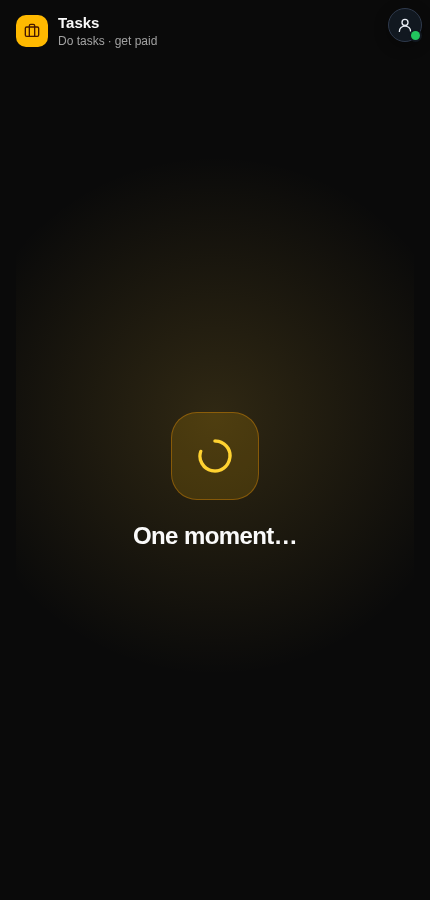 | 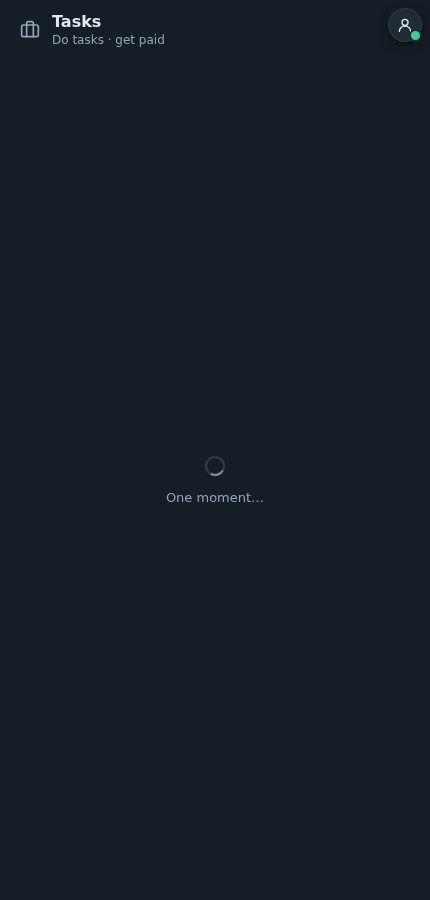 |
| task list | 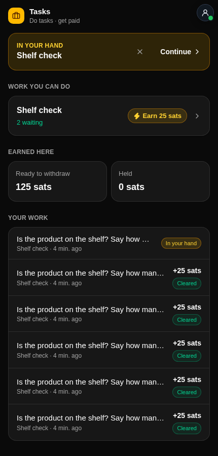 | 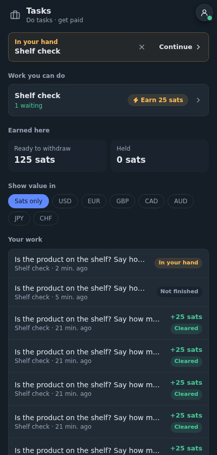 |
| task | 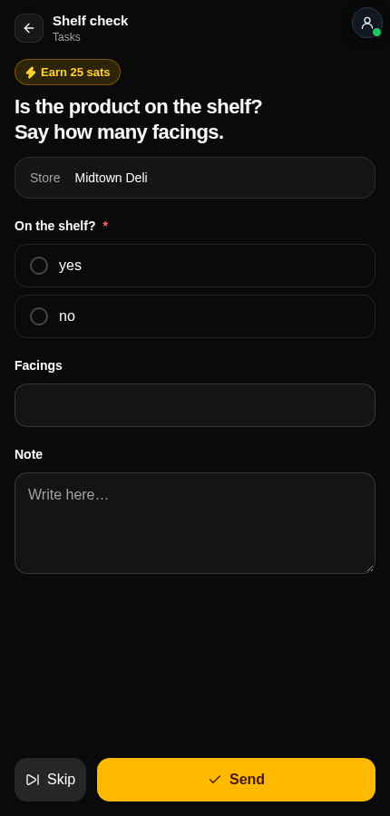 | 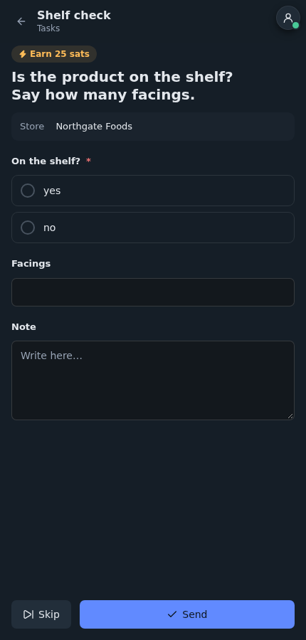 |
| earnings |  |  |
| staff Workers | 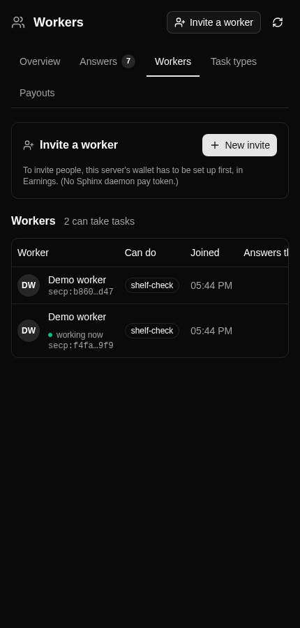 | 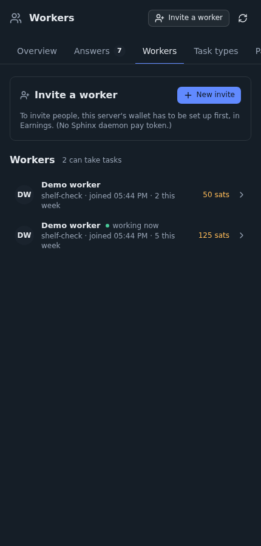 |

Light (after only: the old pages ignored the colour scheme and were dark):

| loading | list | task | earnings | staff Workers |
| --- | --- | --- | --- | --- |
|  |  | 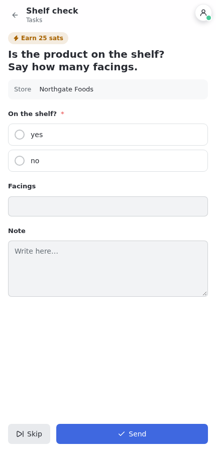 | 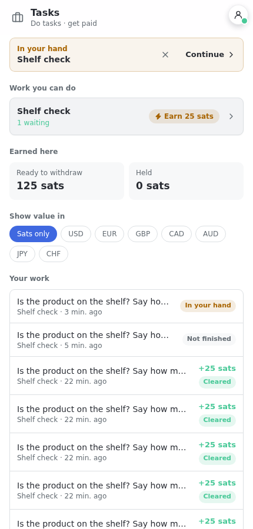 | 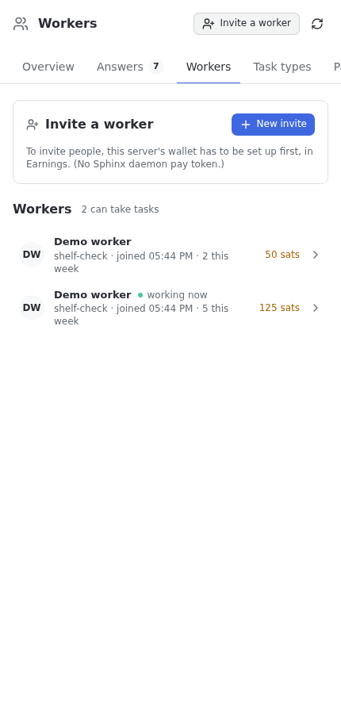 |

Fiat, after switching and reloading: USD 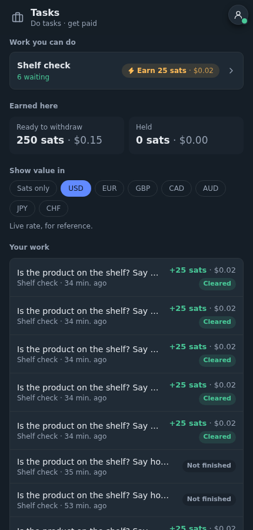 EUR 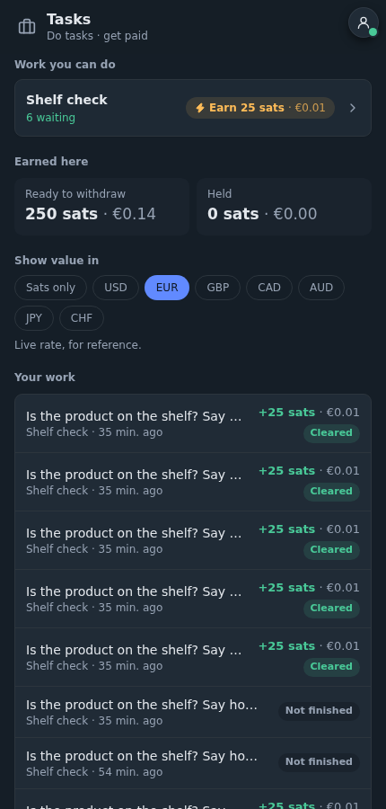

## Not done

- Staff does not show fiat, and the Overview / Payouts / Types tables still scroll sideways on a phone.
- The account widget's panel shows sats only.
